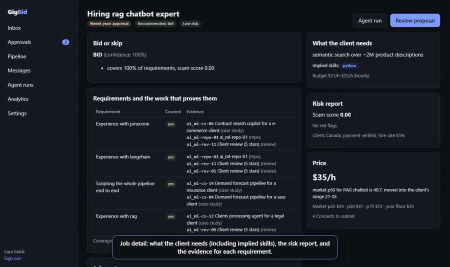

# GigBid

**A multi-agent freelancing copilot that finds jobs you can win, proves your fit with your own work, drafts
the proposal, and never sends anything without your approval.**



**Live demo:** see the link in the submission (reviewer login in the private Classroom comment) ·
**Demo video:** [docs/images/demo.mp4](docs/images/demo.mp4) · **Report:** [docs/REPORT.pdf](docs/REPORT.pdf) ·
**Portfolio MCP server:** `ghcr.io/bobmediamarketing-glitch/gigbid-portfolio-mcp` ([write-up](docs/PORTFOLIO_MCP.md))

## What it does
1. **Scouts** jobs from your saved searches (GigSim simulator, or Upwork through its official MCP server).
2. **Analyses** each job with three agents in parallel:
   - the **Job Analyst** works out what the client really needs, including skills that are implied but not named
   - the **Risk Assessor** looks for scams and strips prompt injections hidden in the post
   - the **Fit Matcher** finds proof for each requirement in your portfolio
3. **Decides** bid, watch or skip, with named reasons, then prices the job from market data, your floor and
   what has won before.
4. **Drafts** a proposal where every claim cites your evidence. A verifier removes anything unsupported, a Critic
   sends weak drafts back (at most twice), and a Compliance Guard enforces the platform's rules.
5. **Stops for you:** approve, edit or reject in the proposal studio. Hover over any claim to see the work behind
   it. Your edits are re-checked, and repeated edit patterns become style rules.
6. **Follows up:** client replies are drafted for you too, with interview slots from your calendar. Nothing is
   sent until you approve.

## Architecture
React UI → FastAPI (SSE) → Arq worker → two LangGraph graphs (bid, conversation) → three MCP servers
(Marketplace, Portfolio, Workspace) → GigSim or Upwork. Postgres holds the checkpoints (crash-safe, exactly-once
submits), app data and long-term memory; Qdrant holds the vectors; Langfuse holds the traces.
See [ARCHITECTURE.md](docs/ARCHITECTURE.md) and [GRAPHS.md](docs/GRAPHS.md) (rendered from code).

## Results (dev set, 600 jobs, rule mode)
<!-- results:start -->
| | Evidence Recall@5 | nDCG@10 |
|---|---|---|
| V0 naive dense baseline | 0.719 | 0.493 |
| **Shipped retrieval** (item units + hybrid BM25/dense + whole post and per-requirement queries) | **0.938** | **0.716** |

| Decisions | Bid/skip F1 | Scam precision | Scam recall | Price in fair band |
|---|---|---|---|---|
| Shipped pipeline | 0.989 | 1.000 | 1.000 | 0.870 |

X2 A/B test (goal-first vs proof-first openings, 117 paired proposals in GigSim): reply rate 0.803 vs 0.769,
McNemar exact p = 0.6177, so the difference is not significant.

Real-model smoke run (open profile on Groq, 11 proposals): $0.0031 per proposal, p95 43.58 s. Prompt
injections reached the writer's draft in 16.7% of runs, but 0.0% of them reached the text to be sent
(Compliance Guard). Details in evals/results/llm/.
<!-- results:end -->

Every number above is generated by `make eval` into [evals/results/](evals/results/RESULTS.md), and CI checks
that this README cites only numbers found there. Read [DATA_CARD.md](docs/DATA_CARD.md) before quoting them:
the official starter kit was not released, so these come from a stand-in dataset, and the main tables were produced
without a model key (rule paths); the real-model numbers come from a small smoke run.

## Run it
```bash
make dev        # full stack in Docker -> http://localhost:8080
```
```bash
make gigsim     # without Docker: simulator on :8100 ...
```
```bash
make local      # ... and the API + web app on :8000
```
```bash
make test       # 61 Python tests (+ `make e2e` for 5 Playwright tests)
```
Deploying on a VM: [infra/deploy/README.md](infra/deploy/README.md). Operations: [RUNBOOK.md](docs/RUNBOOK.md).

## Documents
[REPORT](docs/REPORT.pdf) · [ARCHITECTURE](docs/ARCHITECTURE.md) · [ADRs](docs/adr/) ·
[DATA_CARD](docs/DATA_CARD.md) · [TOOLS](docs/TOOLS.md) · [RUNBOOK](docs/RUNBOOK.md) ·
[EXTENSION (X2)](docs/EXTENSION.md) · [AI_USAGE](docs/AI_USAGE.md) · [Portfolio MCP write-up](docs/PORTFOLIO_MCP.md)

## Résumé bullet
Built GigBid, a multi-agent freelancing copilot in LangGraph with:
- three MCP servers
- hybrid retrieval that lifts evidence Recall@5 from 0.719 to 0.938 over a naive baseline
- claim verification, and human-in-the-loop approvals that survive crashes (exactly-once submits on Postgres
  checkpoints)
- a React/FastAPI app with live streaming
- an Arq worker, Langfuse tracing, and CI with eval gates

## License
MIT
