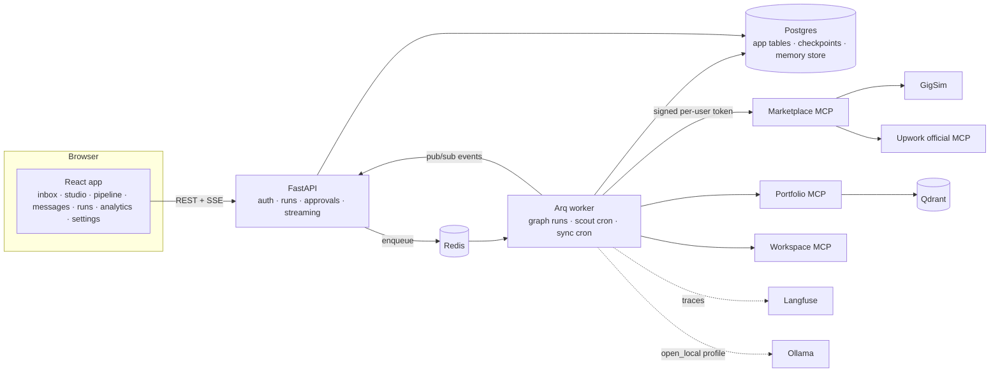

# Architecture

GigBid is a freelancing copilot. It finds jobs that fit, proves the fit with the freelancer's own work,
prices and drafts the proposal, and then **stops and waits for a human**. Nothing is submitted, sent or spent
without an approval in the UI.

## System

* **One port for marketplaces (R1).** `agent/marketplace_port.py` defines one interface with two adapters,
  GigSim and live Upwork. Only the Marketplace MCP server knows which adapter is active, and the graph never does.
* **Agents only see MCP tools (R2).** Each agent has a tool allowlist (`mcp.allowlists` in config), enforced
  before a request leaves the process. The Risk agent cannot submit, and the writer cannot touch the marketplace.
* **Durable runs (C6).** Every super-step is checkpointed in Postgres. Approvals are LangGraph interrupts
  read back from the checkpoint, so they survive refreshes, API restarts and worker crashes. Submits are
  idempotent, so a resumed run submits exactly once.

Both graphs are rendered from code in [GRAPHS.md](GRAPHS.md).

## Why each agent exists

| Agent | Job | Why it is separate | Model / rule path |
|---|---|---|---|
| **Scout** (`nodes/scout.py`) | Turns saved searches into new jobs on a schedule | Reads only; owns pacing (polite intervals in live mode) and never re-hands a job it has seen | none |
| **Job Analyst** (`nodes/analyst.py`) | Post → `JobSpec`: requirements, implied skills, read-check word | Implied skills ("async Python API with automatic docs" → FastAPI) are the corpus's main trap; one place resolves them | 8B model; parser fallback |
| **Risk Assessor** (`nodes/risk.py`) | Scam patterns, client history, removed injections → `RiskReport` | Must run on every job and be cheap; rules catch known scams precisely, and a model can never clear a rule hit | rules + model for new patterns |
| **Fit Matcher** (`nodes/matcher.py`) | Per requirement: retrieve proof from the Portfolio server → `FitReport` | Decides *what the writer may claim*. Coverage drives bid/skip, and the evidence drives the proposal | retrieval only |
| **Decision** (`nodes/decide.py`) | Bid, watch or skip, with named reasons | Deterministic and explainable; every threshold lives in config | rules |
| **Pricing Strategist** (`nodes/pricing.py`) | Market percentiles + floor + client range + outcome memory → `PriceQuote` | Price is numeric and auditable, so it is not left to a model | rules + memory |
| **Proposal Writer** (`nodes/writer.py`) | Grounded cover letter and screening answers with `[evidence-id]` markers | The only creative step, and it is given only proven evidence | 70B model; template fallback |
| **Claim verifier** (`nodes/verifier.py`, `rag/verify.py`) | Labels each claim supported, partly supported or unsupported; removes or rewrites | Hallucinated experience is the most damaging failure; this check sits between the writer and everything else | rules |
| **Critic** (`nodes/critic.py`) | Scores the draft against a client-eyed rubric; sends it back at most twice | A second model family judges the writer's work | different model + rubric |
| **Compliance Guard** (`nodes/compliance.py`) | Policy-pack rules (config), platform limits, injection-echo check | Policy changes are config edits; it re-checks every human edit too | rules |
| **Client Liaison** (`nodes/liaison.py`) | Conversation graph: classify intent, gather evidence or slots, draft, verify, comply, approve, send | Conversations have different risks: negotiation floors, off-platform pushes, calendar holds | model + fixed safe replies for scams |

## State, trace and memory are kept apart (C2)

| | What | Where |
|---|---|---|
| **State** | What this job or conversation needs now | `agent/state.py`, `agent/conversation.py`: typed, with reducers where parallel branches write |
| **Execution trace** | Every node's latency, model, tokens and cost; every tool call | `state.trace`, the MCP audit log (PII-masked), Langfuse (one trace id per thread) |
| **Long-term memory** | Only promoted knowledge | LangGraph store: style rules learned from edits, and outcome lessons per category. The gates are in `agent/memory/promotion_rules.py` |

## Safety (R9, E4)

* **Untrusted text.** Job posts and client messages are untrusted. Injections are stripped before any model
  sees the text: whole lines for posts, single sentences for chat messages. What remains is fenced in
  `<untrusted>` tags, and Compliance blocks any echo of the injected text. The before/after attack success
  rate is in `evals/results/injection.json`.
* **Masking.** Emails, phones, card numbers and tokens are masked in the audit log and in traces.
* **Never automatic.** Auto-skip of low-fit jobs is optional (Settings → Autonomy), but there is no auto-send path anywhere.
* **Live mode.** Drafts only, never auto-submitted. Reads are paced (RUNBOOK). There is no scraping, browser
  automation or session cookie use.

## Decisions

See [adr/](adr/):
- 0001: stand-in starter kit
- 0002: bid graph design
- 0003: what retrieval ships
- 0004: memory and the conversation graph
- 0005: worker, tracing and deployment
