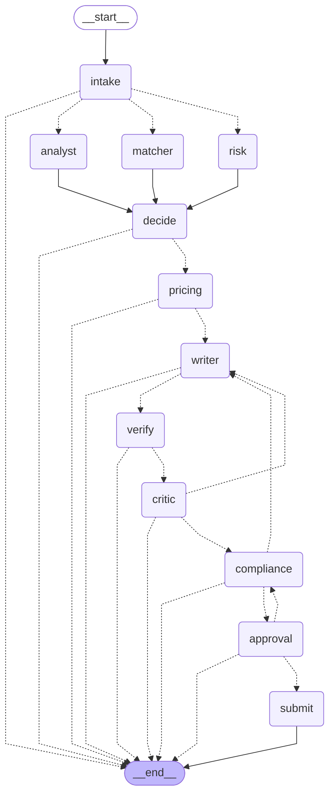
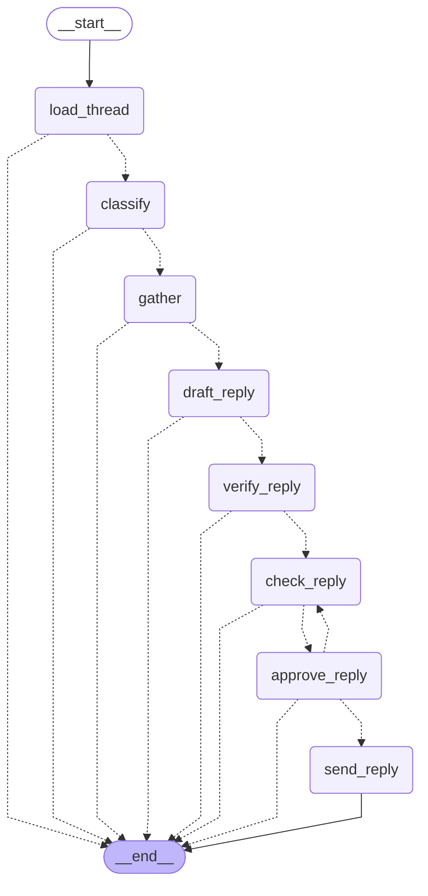

# GigBid graphs

Generated by `python scripts/render_graphs.py` from the compiled graphs. Dashed edges are conditional; every node can also route a halted run to `__end__`.

## Bid graph (one thread per job)

Source: `agent/graphs/bid_graph.py`

## Conversation graph (one thread per client conversation)

Source: `agent/graphs/conversation_graph.py`

